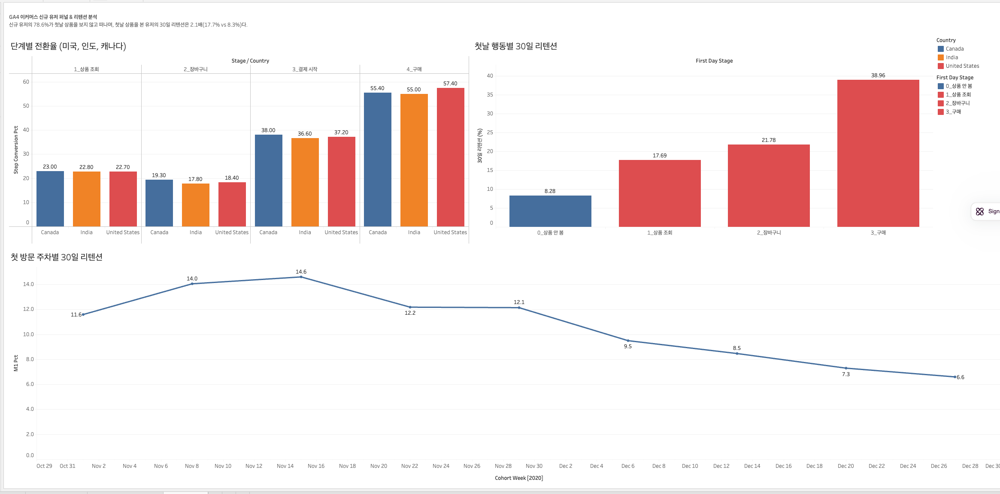

# GA4 E-commerce Growth Analysis: 신규 유저 Activation과 리텐션

Google Merchandise Store의 GA4 이벤트 로그(약 3개월, 일 4천여 명 방문)를 BigQuery로 분석해, **신규 방문자가 구매와 재방문에 이르지 못하는 지점**을 찾고 개선 우선순위와 검증용 A/B 테스트를 설계한다.

> 📄 **[분석 보고서 (REPORT.md)](REPORT.md)** · 📊 대시보드: 아래 이미지 (Tableau Public 링크 추가 예정)



## Business Question

> 신규 방문자의 대부분이 첫 구매 없이 이탈한다. **어느 단계에서, 어떤 유저가** 이탈하며, 무엇을 먼저 개선해야 하는가?

세부 질문
1. 첫 방문에서 구매까지의 퍼널 중 이탈이 가장 큰 구간은 어디인가
2. 재방문(리텐션)을 예측하는 초기 행동, 즉 Activation 기준은 무엇인가
3. 국가(미국, 캐나다, 인도)에 따라 퍼널은 어떻게 다른가
4. 가장 큰 개선 기회를 검증하려면 어떤 실험을 설계해야 하는가

## Key Findings

- 2020-12-01 기준 유저 4,308명이 이벤트 71,804건을 남겼다(1인당 약 16.7건). 유저 여정 샘플에서 프로모션 배너에는 반응했지만 상품 상세에 도달하지 못하고 첫 세션에서 이탈하는 패턴을 확인했고, 이를 이후 퍼널 분석의 가설로 삼았다. ([01](notes/01_explore_data.md))
- 방문자의 구매 전환율은 2.3%이며, **가장 큰 이탈은 방문 → 상품 조회 구간**이다. 방문자의 72.5%가 상품 상세를 보지 않고 이탈한 반면, 결제 시작 이후 단계의 전환율은 51~73%로 상대적으로 높다. 결제 개선보다 첫 방문 유저의 상품 도달이 우선 과제라는 가설을 세웠다. ([02](notes/02_event_overview.md))
- 3개월 전체 기준 상위 10개국의 구매 전환율은 1.33~1.75%로, 국가 간 차이가 통계적으로 유의하지 않다(미국 vs 캐나다 z ≈ 1.16). 최종 전환율이 아닌 퍼널 단계별로 국가 차이를 확인할 필요가 있다. ([03](notes/03_country_conversion.md))
- 미국·캐나다·인도의 단계별 퍼널도 모든 구간에서 차이가 1.4%p 이내로 거의 같다. 방문자의 약 77%가 상품을 보지 않고, 상품 조회자의 약 79%가 장바구니에 담지 않아 **병목은 전 시장 공통의 앞단**이다. 국가별 현지화보다 공통 앞단 개선이 우선이다. ([04](notes/04_user_level_funnel.md))
- 이벤트 순서를 검증하면 **장바구니 → 결제 시작 전환율이 약 77%에서 약 37%로 절반 이하**가 된다. 순서대로 장바구니에 담은 유저의 약 63%가 결제를 시작하지 않아, 장바구니 이탈이 세 번째 병목으로 드러났다. 정상 경로로 구매한 유저는 전체 구매자의 절반 남짓이다. ([05](notes/05_ordered_funnel.md))
- 신규 유저의 30일 리텐션은 10.6%로, **약 89%가 한 달 안에 돌아오지 않는다.** 특히 연말 시즌 코호트는 유입이 가장 많았지만 30일 리텐션이 11월 평균 12.8%에서 12월 8.3%로 떨어졌다. 시즌 유입은 규모가 아닌 코호트 리텐션으로 평가해야 한다. ([06](notes/06_cohort_retention.md))
- 첫날 상품을 본 신규 유저의 30일 리텐션은 17.7%로, 보지 않은 유저(8.3%)의 **2.1배**다. 신규 유저의 78.6%가 이 경계에 걸려 있어 **"첫 방문일 상품 상세 조회"를 Activation 기준**으로 정했다. 인과 검증을 위해 첫 화면 상품 노출 A/B 테스트를 설계한다. ([07](notes/07_activation.md))
- 첫 화면 인기 상품 노출 A/B 테스트를 설계하고(주 지표: 첫날 상품 조회율, 가드레일: 구매율, 그룹당 6,800명), 가상 데이터로 분석 절차를 시연했다. 상품 조회율 +1.63%p(95% CI +0.25~+3.00%p, p = 0.020), 구매율은 유의한 변화 없음 → 사전 판단 규칙에 따라 적용. ([08 설계](notes/08_ab_test_design.md) · [08 분석](notes/08_ab_test_result.md))

## Approach

| # | 분석 | 핵심 방법 | 결과 |
| --- | --- | --- | --- |
| 01 | 데이터 구조 및 유저 여정 탐색 | 이벤트 로그 단위 파악, 유저 단위 시계열 추적 | [notes](notes/01_explore_data.md) · [sql](sql/01_explore_data.sql) |
| 02 | 이벤트 분포 | 이벤트별 건수·도달 유저 집계, 단계별 전환율 | [notes](notes/02_event_overview.md) · [sql](sql/02_event_overview.sql) |
| 03 | 국가별 구매 전환 | 조건부 집계, CTE, 신뢰구간·두 비율 z-검정 | [notes](notes/03_country_conversion.md) · [sql](sql/03_country_conversion.sql) |
| 04 | 유저 단위 퍼널 (미국·캐나다·인도) | 유저당 1행 변환, 0/1 플래그 집계 | [notes](notes/04_user_level_funnel.md) · [sql](sql/04_user_level_funnel.sql) |
| 05 | 순서 기반 퍼널 | 단계별 최초 시각, 다층 CTE로 순서 검증 | [notes](notes/05_ordered_funnel.md) · [sql](sql/05_ordered_funnel.sql) |
| 06 | 코호트 리텐션 | 신규 유저 주간 코호트, 누적 리텐션, JOIN·날짜 함수 | [notes](notes/06_cohort_retention.md) · [sql](sql/06_cohort_retention.sql) |
| 07 | Activation 정의 | 첫날 행동 세그먼트(CASE WHEN)별 30일 리텐션 비교 | [notes](notes/07_activation.md) · [sql](sql/07_activation.sql) |
| 08 | A/B 테스트 설계 및 검정 | 지표 체계(주·보조·가드레일), 표본 크기 산정, 두 비율 z-검정 | [design](notes/08_ab_test_design.md) · [result](notes/08_ab_test_result.md) · [code](notebooks/08_ab_test_analysis.py) |
| 09 | 대시보드 및 최종 보고서 | Tableau 대시보드, 보고서 | [report](REPORT.md) · [data](data/) |

## Data

| 항목 | 내용 |
| --- | --- |
| 출처 | BigQuery 공개 데이터셋 `bigquery-public-data.ga4_obfuscated_sample_ecommerce` |
| 기간 | 2020-11-01 ~ 2021-01-31 (일별 파티션 테이블 `events_YYYYMMDD`) |
| 단위 | 1 row = 1 event (유저의 행동 하나) |
| 주요 필드 | `user_pseudo_id`, `event_timestamp`, `event_name`, `event_params`, `geo.country`, `device.category`, `traffic_source` |

**한계**: 공개용으로 일부 값이 난독화(obfuscated)되어 있어 절대 수치보다 구간 간 상대 비교에 초점을 둔다. 실험 데이터가 없어 A/B 테스트는 설계와 공개 실험 데이터 기반 검정으로 대체한다.

## Repository Structure

```
.
├── sql/        분석 단계별 BigQuery 쿼리
├── notebooks/  Python 분석 (A/B 테스트)
├── images/     결과 그래프, 대시보드
├── notes/      단계별 분석 목적, 결과, 해석
├── data/       대시보드용 집계 CSV
└── REPORT.md   최종 분석 보고서
```

## Tech Stack

BigQuery (Standard SQL) · Python (pandas, scipy, statsmodels, matplotlib) · Tableau Public
