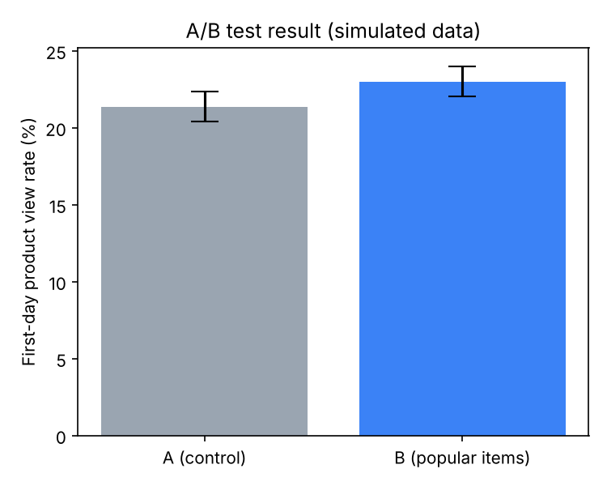

# 08-2. A/B 테스트 분석 (가상 데이터로 분석 절차 시연)

> **이 분석은 실제 실험 결과가 아니다.** 원본 데이터에는 실험 기록이 없으므로, 설계서([08_ab_test_design.md](08_ab_test_design.md))의 가정으로 유저 단위 데이터를 생성해 분석 절차를 시연했다.
> 가정: 그룹당 7,000명, 첫날 상품 조회율 A 21.4% / B 23.6%, 첫날 구매율 A·B 모두 0.96%
> 코드: [notebooks/08_ab_test_analysis.py](../notebooks/08_ab_test_analysis.py)

## 1. 배정 비율 점검 (SRM)
A 7,000명, B 7,000명, 카이제곱 검정 p = 1.000 → 50:50 배정에 문제 없음.
배정 비율이 크게 어긋나면(p < 0.05) 배정 로직 오류 가능성이 있어 결과를 신뢰할 수 없으므로, 지표 분석 전에 먼저 확인한다.

## 2. 지표별 검정 결과

| 지표 | 종류 | A | B | 차이 (B − A) | 95% 신뢰구간 | p-value | 판정 |
| --- | --- | --- | --- | --- | --- | --- | --- |
| 첫날 상품 조회율 | 주 지표 | 21.37% | 23.00% | **+1.63%p** (상대 +7.6%) | +0.25 ~ +3.00%p | **0.020** | ✅ 유의하게 상승 |
| 첫날 구매율 | 가드레일 | 1.13% | 0.93% | −0.20%p | −0.53 ~ +0.13%p | 0.241 | ⚠️ 유의한 변화 없음 |

- 검정: 두 비율 z-검정(`proportions_ztest`), 신뢰구간: Wald 방식(`confint_proportions_2indep`)

## 3. 해석
- **주 지표:** B의 상품 조회율이 1.63%p 높고, 신뢰구간 전체가 0보다 크며 p = 0.020 < 0.05 → "두 그룹의 상품 조회율이 같다"는 귀무가설을 기각한다.
- **효과 크기:** 신뢰구간 하한(+0.25%p)이 설계 시 정한 최소 의미 효과(+2%p)보다 작다. 효과는 있지만 기대보다 작을 가능성도 있다.
- **관측값과 가정값의 차이:** 데이터 생성 시 가정한 진짜 차이는 +2.2%p였지만 관측값은 +1.63%p였다. 7,000명 규모에서도 표본 변동이 이만큼 있다는 뜻이며, 진짜 값(+2.2%p)은 신뢰구간 안에 포함됐다.
- **가드레일:** 구매율 차이는 유의하지 않다. 다만 방향은 음수이고, 기저율이 약 1%로 낮아 이 표본 크기로는 약 0.5%p(기존의 절반 수준) 이상의 큰 하락만 검출할 수 있다(검정력 80% 기준). "악화가 없다"가 아니라 "큰 악화는 없다"로 해석한다.

## 4. 결론과 다음 행동
- 사전 판단 규칙(주 지표 유의하게 상승 + 가드레일 유의한 악화 없음)에 따라 **성공 → B 적용**.
- 단, 구매율은 검정력이 낮으므로 적용 후에도 구매율을 계속 모니터링한다.
- 보조 지표인 30일 리텐션은 배정 종료 후 30일 관찰을 마친 뒤 같은 방식으로 검정한다.
